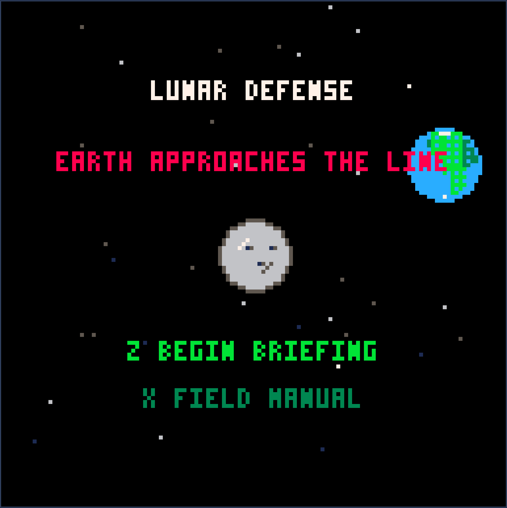
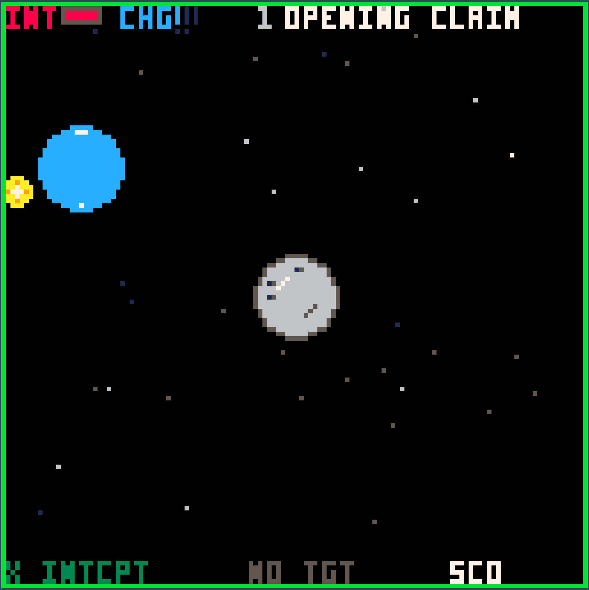

# Lunar Defense

A strategic cislunar orbital defense game built for [PICO-8](https://www.lexaloffle.com/pico-8.php).

**[Play in Browser](https://smkwray.github.io/lunardefense-p8/demo/)**

 

## Story

Earth has crossed the line. After years of escalating tension in cislunar space, Earth's orbital command has launched a full assault on the Moon's defensive garrison. You command the Moon's automated defense grid — a network of interceptors, salvage tugs, and heavy weapons systems embedded beneath the lunar surface.

What Earth doesn't know is that the Moon isn't just a rock. It's a machine.

Survive five increasingly brutal assault packets. Destroy Earth's orbital infrastructure — shipyards, jammers, and aegis shields. When Earth finally falls, face the capital ship that emerges from the wreckage. Hold the Moon at all costs.

## Gameplay

The Moon sits at the center of the screen. Earth orbits around it, launching hostile contacts along curved transfer arcs. You select targets and fire — interceptors home automatically on incoming threats, while outbound strikes require manual aim with real orbital physics.

### Core Loop

1. **Scan** — cycle through incoming contacts with Left/Right
2. **Intercept** — press Z to auto-launch a homing interceptor at the selected threat
3. **Strike** — switch to sling or chunk with X, select an Earth module, press Z to enter aim mode
4. **Aim** — adjust your launch angle (L/R/U/D), Z fires, X cancels. Gravity curves your shot toward Earth. Bad aim can miss entirely or boomerang back and hit your own Moon.
5. **Salvage** — destroyed contacts near the Moon leave debris. An auto-tug collects it, converting scrap into weapon charge.
6. **Upgrade** — between assault packets, choose one of three upgrades to adapt your defenses.

### The War

**5 assault packets**, each introducing new threats and Earth modules:

1. **Opening Claim** — basic raiders and your first wrecker. Learn to intercept.
2. **Orbital Denial** — Earth deploys a shipyard (spawns extra raiders) and a jammer (degrades interceptor accuracy). Sling weapon unlocked.
3. **General War** — heavier pressure, more orbiters dropping bombs from lunar orbit.
4. **Aegis Breach** — Earth deploys an aegis shield that blocks your outbound strikes. Moon chunk weapon unlocked — the only thing that punches through.
5. **Core Breach** — double shipyards, double jammers, aegis. Destroy Earth's core to trigger the endgame.

### Boss Phase

When Earth's core falls, the planet splits in half. A capital ship emerges from the wreckage. Cross-shaped shields deploy around the Moon. The boss orbits your position, firing volleys of arcing shots. You fight back with slings and chunks — the boss dodges chunks, so you need to lead your shots. Destroy the capital ship to win.

## Controls

| Key | Action |
|-----|--------|
| Left/Right | Cycle target |
| Z | Fire interceptor / confirm |
| X | Switch weapon |
| Up/Down | Also cycles targets (same as L/R) |
| Enter/P | Pause |

**Aim mode** (outbound strikes): Left/Right/Up/Down adjust aim direction, Z fires, X cancels back to interceptor mode.

**Intermission**: Up/Down selects upgrade, Z confirms.

## Enemies

| Enemy | Description |
|-------|-------------|
| **Raider** | Fast, fragile (1 HP). The bread and butter of Earth's assault. |
| **Wrecker** | Slow, tough (2 HP), devastating impact (6 damage). Accelerates over time with visible engine flare. |
| **Sapper** | Orbits the Moon before diving. Drops bombs during orbit phase. 3 damage on impact. |
| **Decoy** | Harmless drone. Wastes your interceptors if you're not paying attention. |

## Weapons

| Weapon | Cost | Damage | Notes |
|--------|------|--------|-------|
| **Interceptor** | 1 charge | 1 | Auto-homing. Select contact, press Z. |
| **Sling** | 2 charge | 2 | Manual aim. Gravity-curved trajectory toward Earth. Good for modules. |
| **Moon Chunk** | 3 charge | 3 | Manual aim. Tears a piece off the Moon itself. Permanently reduces max integrity. The only weapon that bypasses aegis shields. |

Chunks are powerful but costly — each launch permanently reduces your Moon's maximum health by 3 and costs 3 current integrity on top of the charge cost. Use them wisely.

## Upgrades

| Upgrade | Effect |
|---------|--------|
| **Fast Reload** | Charge regenerates faster |
| **Reserve Tanks** | Raise max charge from 3 to 5 |
| **Patch Crews** | Better salvage repairs + slow passive moon healing |
| **Recycler** | Faster tug operations, easier charge gain from salvage |
| **Point Defense** | Auto-zaps the nearest non-decoy threat every few seconds (2 damage, short range) |
| **Refinery** | Delivered salvage mass counts double |
| **Mass Driver** | Moon chunks deal +1 damage |
| **Lunar Shielding** | +2 max moon integrity |
| **Pulse Array** | Long-range auto-zap (1 damage, wider reach than point defense) |

## Earth Modules

Earth deploys orbital infrastructure that makes your life harder:

| Module | Effect |
|--------|--------|
| **Shipyard** | Periodically spawns extra raiders |
| **Jammer** | Degrades interceptor accuracy |
| **Aegis** | Energy shield arc that blocks sling shots. Only chunks punch through. |

Destroying modules with outbound strikes is key to surviving later packets.

## Technical Details

- **Platform:** PICO-8 (128x128 resolution, 16-color palette)
- **Tested on:** [FAKE-08](https://github.com/jtothebell/fake-08) open-source emulator
- **Browser version:** Complete JavaScript port using Canvas 2D pixel buffer and Web Audio API
- **Audio:** 16 gameplay SFX, 14 music SFX for title theme, 18 music SFX for gameplay/boss banks, reactive audio accents

### Files

- `lunar_defense.p8` — PICO-8 cart (primary source of truth)
- `demo/index.html` + `demo/game.js` — Browser-playable static site (no build step required)
